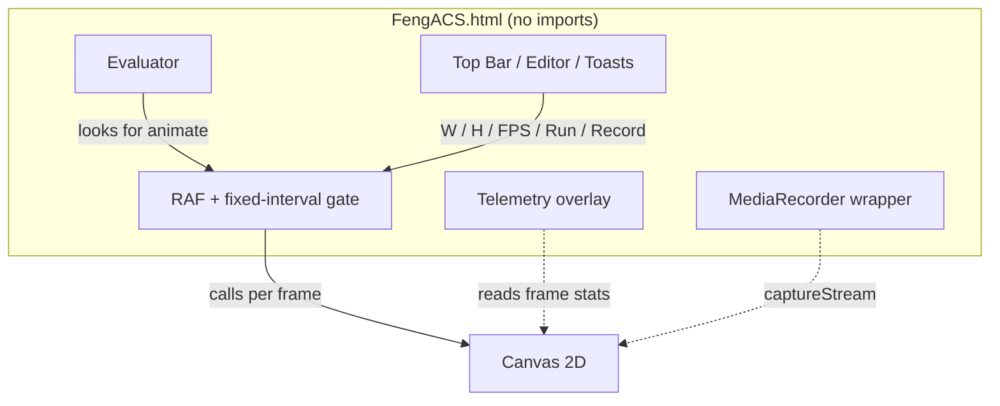

<!--
  ┌──────────────────────────────────────────────────────────────┐
  │  FengACS  ·  Feng Animation Code Studio                       │
  │  Write. Render. Record. Export. — zero build, zero server.   │
  └──────────────────────────────────────────────────────────────┘
-->
<h1 align="center"><code>FengACS</code> — Feng Animation Code Studio</h1>
<p align="center"><b>A single-file, zero-dependency browser IDE for HTML5 Canvas animations.</b></p>

<p align="center">
  <a href="#"></a>
  <a href="#"></a>
  <a href="#"></a>
  <a href="#"></a>
  <a href="#"></a>
  <a href="#"></a>
</p>

> **FengACS** (Feng Animation Code Studio) is an entire animation IDE squeezed into **one HTML file**.
> You write a single `animate()` function, watch it render live beside the editor, lock the cadence to
> **24–144 FPS**, and export the result as a **WebM** video — with no build step, no server, no install,
> and *no network at runtime*.
>
> > *"Write an `animate()`, watch it live, export a WebM. That's it."*

---

## Table of Contents

- [Highlights](#-highlights)
- [Quick Start](#-quick-start)
- [The Sketch API](#-the-sketch-api)
  - [Available Names inside `animate()`](#available-names-inside-animate)
  - [Keeping State across Frames](#keeping-state-across-frames)
- [Sketch Authoring Rules](#-sketch-authoring-rules)
  - [Runtime Contract](#runtime-contract)
  - [Do not touch the DOM](#do-not-touch-the-dom)
- [Frame Loop & FPS Governor](#-frame-loop--fps-governor)
- [Settings](#-settings)
- [Recording & Export Pipeline](#-recording--export-pipeline)
- [Interface Reference](#-interface-reference)
- [Included Example — PERFTEST.js](#-included-example--perftestjs)
- [Architecture](#-architecture)
- [Browser Support](#-browser-support)
- [Known Limitations](#-known-limitations)
- [Roadmap](#-roadmap)
- [Project Structure](#-project-structure)
- [Contributing](#-contributing)
- [Author](#-author)
- [License](#-license)

---

## Highlights

| Capability | What you get |
| :--- | :--- |
| **Truly self-contained** | One `FengACS.html`. No frameworks, no CDN, no external assets, no network. |
| **Live split-pane preview** | Editor left, canvas right — both visible at once, updated live. |
| **Frame-rate governor** | Fixed-interval gate at `24 / 30 / 60 / 120 / 144 FPS` with drift correction. |
| **In-page video export** | `canvas.captureStream()` + `MediaRecorder` → `WebM` @ 8 Mbps. |
| **Real-time telemetry** | Measured FPS, frame counter, elapsed time, run / record status. |
| **Resolution up to 4K** | `W` ∈ `[100, 3840]`, `H` ∈ `[100, 2160]`. |
| **Tiny familiar sketch API** | `canvas`, `ctx`, `width`, `height`, `t`, `dt`, `frame` — free. |

---

## Quick Start

1. **Download or clone** this repository.

   ```bash
   git clone https://github.com/FengPwner/FengACS.git
   cd FengACS
   ```

2. **Open** `FengACS.html` in any modern browser — `file://` works fine, no server needed.

3. **Paste** a sketch into the editor:

   ```js
   function animate() {
     ctx.fillStyle = "#050510";
     ctx.fillRect(0, 0, width, height);

     ctx.save();
     ctx.translate(width / 2, height / 2);
     ctx.rotate(t * 1.5);
     ctx.fillStyle = "hsl(" + ((t * 60) % 360) + ", 90%, 60%)";
     ctx.fillRect(-90, -90, 180, 180);
     ctx.restore();
   }
   ```

4. Press **Run** (or <kbd>Ctrl</kbd>/<kbd>Cmd</kbd> + <kbd>Enter</kbd>), then **Record** → **Stop** → **Download**.

> Want something meatier? Load `example/PERFTEST.js` and paste it into the editor — it doubles as
> a stress test *and* an API showcase.

---

## The Sketch API

Your editor contents are evaluated **once per Run**. FengACS then looks for `animate()` and calls it
once per rendered frame.

### Available Names inside `animate()`

| Name | Type | Meaning |
| :--- | :--- | :--- |
| `canvas` | `HTMLCanvasElement` | The preview canvas being rendered to. |
| `ctx` | `CanvasRenderingContext2D` | Its 2D context (pre-fetched). |
| `width` | `number` | Canvas width in pixels — follows the **W** input. |
| `height` | `number` | Canvas height in pixels — follows the **H** input. |
| `t` | `number` | Seconds elapsed since the current Run started. |
| `dt` | `number` | Seconds since the previously rendered frame. |
| `frame` | `number` | Rendered frame count since Run started (starts at `1`). |

### Keeping State across Frames

Because the body runs once, top-level variables persist between frames:

```js
let particles = null;

function animate() {
  if (particles === null) particles = buildParticles(400);
  stepAndDraw(particles);
}
```

> **Note:** The canvas is cleared to black at the start of each Run. Animated sketches should
> repaint or clear every frame.

---

## Sketch Authoring Rules

FengACS is a **canvas-only** studio. A sketch owns exactly one thing: *what gets painted into `ctx`
this frame.*

### Runtime Contract

- You are given `canvas`, `ctx`, `width`, `height`, `t`, `dt`, `frame`.
- Define **only** `function animate() { … }` — no own `requestAnimationFrame` loop, no
  `canvas.getContext('2d')`.
- Origin `(0, 0)` is the **top-left**; `x` grows right, `y` grows down.

### Do not touch the DOM

| ❌ Forbidden | ✅ Use instead |
| :--- | :--- |
| `document.createElement` / `appendChild` | `ctx.fillRect`, `ctx.arc`, `ctx.beginPath` + paths |
| `innerHTML` / `textContent` | `ctx.fillText` / `ctx.strokeText` |
| `document.querySelector` | The pre-injected `canvas` / `ctx` |
| CSS positioning / `z-index` / `transform` | Draw order — later `ctx` calls paint on top |
| Flex / grid layout | Explicit pixel maths from `width` / `height` |
| Own animation timing | `t`, `dt`, `frame` supplied by the host |

> **Why so strict?** The export path is `canvas.captureStream()` + `MediaRecorder`, which captures
> **the canvas pixels and nothing else**. Any DOM overlay silently vanishes from the downloaded `.webm`.

### Checklist before you press Record

- [x] Does the sketch consist of one `animate()` function (plus optional top-level state)?
- [ ] Is every visible pixel drawn through `ctx`?
- [ ] Are positions computed from `width` / `height` rather than hard-coded?
- [ ] Do you clear or repaint each frame, so nothing leaks from the previous one?
- [ ] Is anything you *wouldn't* want in the recording (debug HUD) drawn on purpose?

---

## Frame Loop & FPS Governor

Rendering uses `requestAnimationFrame` behind a **fixed-interval gate**:

```js
next_frame += 1000 / FPS;          // accumulate the next permitted frame time
if (now - next_frame > 2 ticks) {  // fell too far behind (tab switch / GC pause)?
  next_frame = now;                // snap back to "now" instead of bursting frames
}
```

- Choosing `60` on a 144 Hz monitor still yields a steady **60 FPS**.
- `dt` stays honest under load.
- Measured rate is recomputed once per second and shown in the top-left overlay.

---

## Settings

| Control | Range / Values | Default | Effect |
| :--- | :--- | :--- | :--- |
| **W** | `100 – 3840` | `1280` | Canvas width in pixels |
| **H** | `100 – 2160` | `720` | Canvas height in pixels |
| **FPS** | `24 / 30 / 60 / 120 / 144` | `60` | Target render cadence + `captureStream()` |

> Changing **W / H / FPS** while running re-shows **Run** — press it again to restart with the
> new settings.

---

## Recording & Export Pipeline

**Record** restarts the sketch from `t = 0`, attaches a `MediaRecorder`, and starts capturing — a
clean, deterministic take every time.

| Aspect | Behaviour |
| :--- | :--- |
| Stream source | `canvas.captureStream(targetFPS)` |
| Codec order | `vp9` → `vp8` → `video/webm` (first supported wins) |
| Bitrate | `8,000,000` bits/s |
| Chunking | `100 ms` timeslice, buffered into a `Blob` |
| Output | `animation_<epoch-ms>.webm` |


---

## Interface Reference

| Zone | Description |
| :--- | :--- |
| **Top bar** | Size + FPS inputs, **Run**, **Clear**, **Record**, **Download** |
| **Editor** | Monospace textarea, <kbd>Tab</kbd> → 2-space indent, placeholder hints |
| **Preview** | Auto-fitted canvas + FPS overlay + recording overlay |
| **Status bar** | Status dot, frame counter, elapsed time |
| **Toasts** | Slide-in confirmations, auto-dismiss after `2.5 s` |

### Keyboard shortcuts

| Keys | Action |
| :--- | :--- |
| <kbd>Ctrl</kbd>/<kbd>Cmd</kbd> + <kbd>Enter</kbd> | Run sketch |
| <kbd>Tab</kbd> | Insert two spaces |

---

## Included Example — PERFTEST.js

A self-benchmarking sketch that doubles as a stress test and an API showcase:

1. **Intro (first 3s)** — pulsing *"PERF TEST / SYSTEM BENCHMARK"* title over an animated radial gradient.
2. **Live telemetry** — a scrolling 4-series graph over a 300-sample ring buffer (`FPS`, `FRAME`, `DRAW`, `HEAP`).
3. **Numeric HUD** — FPS avg / current / min / max, frame-time stats, heap, GC events, elapsed time.
4. **Two mini graphs** — a 120-sample frame-time plot and a 120-sample draw-time plot.

> `HEAP` / GC fields rely on `performance.memory`, which is **Chromium-only** — they report zeros
> elsewhere.

---

## Architecture



| Layer | Responsibility |
| :--- | :--- |
| `Evaluator` | Runs the sketch body once, locates `animate()`. |
| `Frame governor` | Enforces the target FPS with drift correction. |
| `Renderer` | Provides `ctx` + auto-fits the canvas. |
| `Recorder` | Streams canvas frames into a WebM blob. |
| `Telemetry` | Reports measured FPS / frame / elapsed time. |

---

## Browser Support

| Capability | Requirement |
| :--- | :--- |
| Editing & running | Any current browser with **Canvas 2D** |
| Recording & export | `captureStream()` + `MediaRecorder` (Chromium + Firefox; Safari exposes MP4 profiles) |
| `PERFTEST.js` heap / GC | `performance.memory` — Chromium only |

---

## Known Limitations

- **The evaluator is a convenience, not a security boundary** — no iframe, no worker, no sandbox.
  *Do not paste untrusted code.*
- **No persistence** — a page reload loses your sketch.
- **Errors inside `animate()` aren't caught per frame** — they surface in the console.
- **2D context only** — no WebGL / WebGPU helper surface.
- **Fixed export** — 8 Mbps WebM, no MP4 / GIF / MOV path.

---

## Roadmap

- [x] Single-file IDE with live split-pane preview
- [x] FPS governor & WebM export
- [x] Performance-telemetry example sketch
- [ ] Persist sketches to `localStorage`; add save / load / share-as-URL
- [ ] **WebGL / OffscreenCanvas** renderer + context selector
- [ ] Expose bitrate, codec, and container (MP4 where supported)
- [ ] *"Record N seconds then auto-stop"* for deterministic clip lengths
- [ ] Inject a small helper layer (shapes, easing, noise) into the sandbox

---

## Contributing

Contributions are welcome. Please keep the philosophy intact:

1. **One file, zero deps** — no build step, no package manager, no CDN.
2. **Canvas-only surface** — the exported `.webm` must contain exactly what you see.
3. **Backwards compatible** — existing sketches must keep running unchanged.

Report bugs, request features, or open a pull request in the
[issues tab](https://github.com/FengPwner/FengACS/issues).

---

## Author

**FengPwner** — <https://github.com/FengPwner>

> *Stay curious, stay sharp — and always animate with authorization.* [^1]

[^1]: A nod to the security-engineering credo the author lives by.

---

## License

To see [License](https://github.com/FengPwner/FengACS/blob/main/LICENSE)

---


```
┌─────────────────────────────────────────────────────┐
│  F e n g A C S  ·  W r i t e . R e n d e r .       │
│  R e c o r d .  E x p o r t .                       │
└─────────────────────────────────────────────────────┘
```
